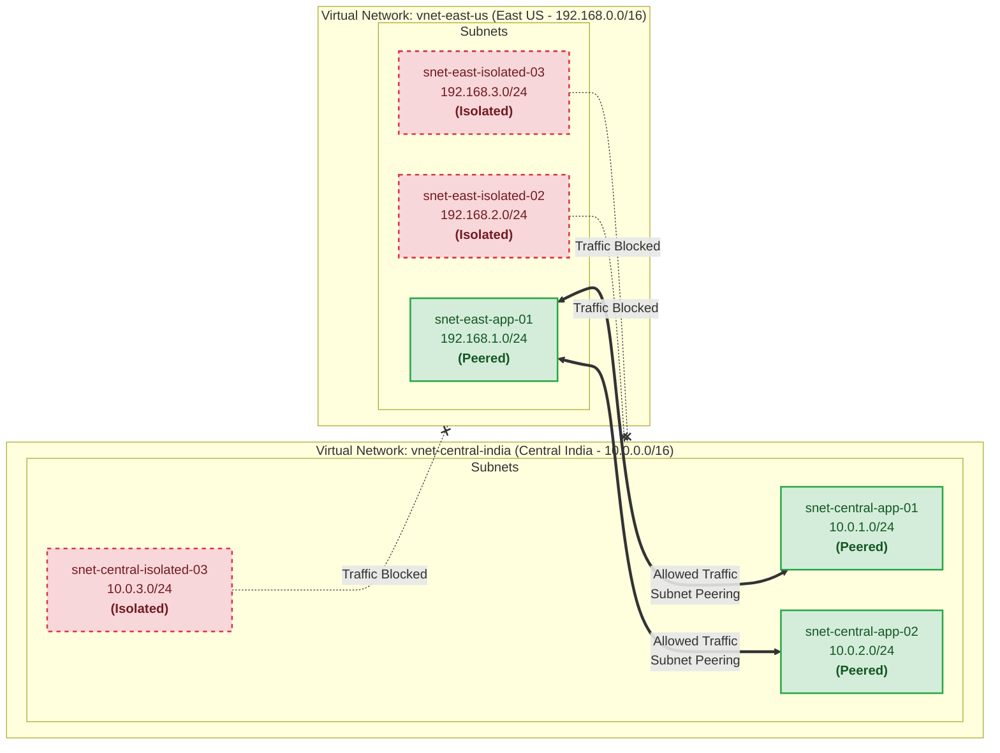

# Azure Granular Subnet-Level VNet Peering

[](https://www.terraform.io/)
[](https://azure.microsoft.com/)
[](https://opensource.org/licenses/MIT)

A clean, production-grade Terraform project demonstrating **Granular Subnet-Level Virtual Network Peering** in Microsoft Azure.

Traditionally, standard Azure VNet peering bridges the *entire* address space of two virtual networks (all subnets can communicate across the peering unless blocked by NSGs). With **Subnet Peering** (`peer_complete_virtual_networks_enabled = false`), Azure allows you to selectively peer specific subnets between VNets while keeping all other subnets strictly isolated at the routing level.

---

## Architecture Diagram

The diagram below illustrates a **1-to-2 Selective Subnet Peering**:
* **`snet-east-app-01`** in **East US** communicates bidirectionally with **`snet-central-app-01`** and **`snet-central-app-02`** in **Central India**.
* All other subnets (`snet-east-isolated-02`, `snet-east-isolated-03`, `snet-central-isolated-03`) remain **strictly isolated** with no cross-region routes.



---

## Traffic Matrix

| Source Subnet | Destination Subnet | Communication Status | Reason |
| :--- | :--- | :--- | :--- |
| **East US** `snet-east-app-01` | **Central India** `snet-central-app-01` | **Allowed** | Explicitly peered (`10.0.1.0/24` $\leftrightarrow$ `192.168.1.0/24`) |
| **East US** `snet-east-app-01` | **Central India** `snet-central-app-02` | **Allowed** | Explicitly peered (`10.0.2.0/24` $\leftrightarrow$ `192.168.1.0/24`) |
| **East US** `snet-east-isolated-02` | **Central India** (Any) | **Blocked** | Subnet excluded from peering configuration |
| **East US** `snet-east-isolated-03` | **Central India** (Any) | **Blocked** | Subnet excluded from peering configuration |
| **Central India** `snet-central-isolated-03` | **East US** (Any) | **Blocked** | Subnet excluded from peering configuration |

---

## Limitations & Considerations

While Subnet Peering provides fine-grained network segmentation, you should consider the following platform limitations before adopting it in production:

| Limitation / Constraint | Details |
| :--- | :--- |
| **Scale Limit** | Azure enforces a maximum limit of **400 subnets per peering connection**. |
| **Azure Virtual WAN (vWAN)** | Subnet-level peering is **not supported** with Azure Virtual WAN secured or standard hubs. |
| **Azure Virtual Network Manager (AVNM)** | AVNM cannot currently differentiate between standard whole-VNet peering and subnet-scoped peering. Managing the same VNets in an AVNM mesh or hub-spoke configuration may conflict with or overwrite subnet peering states. |
| **Azure Portal GUI** | The Azure Portal does not currently feature a visual subnet selector for peering. Subnet peering must be managed via **Terraform, Azure CLI, Azure PowerShell, Bicep/ARM, or REST API**. |
| **Overlapping Subnet CIDRs** | While the overarching VNets can share overlapping address space (one of subnet peering's greatest benefits), the **participating subnets themselves must strictly have unique, non-overlapping IP spaces**. |
| **Symmetric Declaration** | Subnet peering must be configured with exact symmetry: all subnets listed in `local_subnet_names` on Side A must be mapped as `remote_subnet_names` on Side B. |
| **Gateway Transit Nuances** | Gateway transit allows selective spoke subnet exposure to hub VPN/ExpressRoute gateways, but route propagation and gateway transit settings must be deliberately coordinated on both peering directions. |

---

## Repository Structure

```text
├── .gitignore                   # Ignores secrets and terraform state
├── providers.tf                 # AzureRM provider configuration
├── variables.tf                 # Clean, commented input variables
├── terraform.tfvars.example     # Template for credentials (never commit real secrets!)
├── vnet_central_india.tf        # Central India Resource Group, VNet & Subnets
├── vnet_east_us.tf              # East US Resource Group, VNet & Subnets
├── peering.tf                   # Native Subnet-Level VNet Peering resources
├── subnet_to_subnetpeering.sh   # Alternative Azure CLI bash script
├── outputs.tf                   # Prints VNet IDs and verification commands
└── README.md                    # Project documentation & architecture diagram
```

---

## Implementation Details

### Native Terraform Peering ([peering.tf](peering.tf))
The peering is defined natively via `azurerm_virtual_network_peering` using the `peer_complete_virtual_networks_enabled = false` argument:

```hcl
# East US -> Central India
resource "azurerm_virtual_network_peering" "east_us_to_central_india" {
  name                         = "peer-east-us-to-central-india"
  resource_group_name          = azurerm_resource_group.east_us.name
  virtual_network_name         = azurerm_virtual_network.east_us.name
  remote_virtual_network_id    = azurerm_virtual_network.central_india.id
  allow_virtual_network_access = true

  peer_complete_virtual_networks_enabled = false
  local_subnet_names                     = [azurerm_subnet.east_app_01.name]
  remote_subnet_names                    = [
    azurerm_subnet.central_app_01.name,
    azurerm_subnet.central_app_02.name
  ]
}

# Central India -> East US (Symmetrical Reverse Peering)
resource "azurerm_virtual_network_peering" "central_india_to_east_us" {
  name                         = "peer-central-india-to-east-us"
  resource_group_name          = azurerm_resource_group.central_india.name
  virtual_network_name         = azurerm_virtual_network.central_india.name
  remote_virtual_network_id    = azurerm_virtual_network.east_us.id
  allow_virtual_network_access = true

  peer_complete_virtual_networks_enabled = false
  local_subnet_names                     = [
    azurerm_subnet.central_app_01.name,
    azurerm_subnet.central_app_02.name
  ]
  remote_subnet_names                    = [azurerm_subnet.east_app_01.name]
}
```

---

## Deployment & Verification

### 1. Configure Credentials
Copy the example variables file:
```bash
cp terraform.tfvars.example terraform.tfvars
```
Fill in your Azure Service Principal credentials in `terraform.tfvars`.

### 2. Deploy Infrastructure
```bash
terraform init
terraform apply -auto-approve
```

### 3. Verify Peering Status
Run the commands from the Terraform output to verify both sides are connected:

```bash
# Check East US -> Central India
az network vnet peering show \
  --name "peer-east-us-to-central-india" \
  --resource-group "rg-east-us-peering" \
  --vnet-name "vnet-east-us" \
  --query "{State:peeringState, Sync:peeringSyncLevel}" -o table

# Check Central India -> East US
az network vnet peering show \
  --name "peer-central-india-to-east-us" \
  --resource-group "rg-central-india-peering" \
  --vnet-name "vnet-central-india" \
  --query "{State:peeringState, Sync:peeringSyncLevel}" -o table
```

Expected output:
```text
State      Sync
---------  -----------
Connected  FullyInSync
```

### 4. Clean Teardown
Because the peering is managed natively in Terraform state:
```bash
terraform destroy -auto-approve
```
Terraform automatically tears down the peerings first before deleting subnets and VNets, without any Azure dependency conflicts.

---

## Author & License
Designed for enterprise multi-region networking demonstrations. Distributed under the MIT License.
